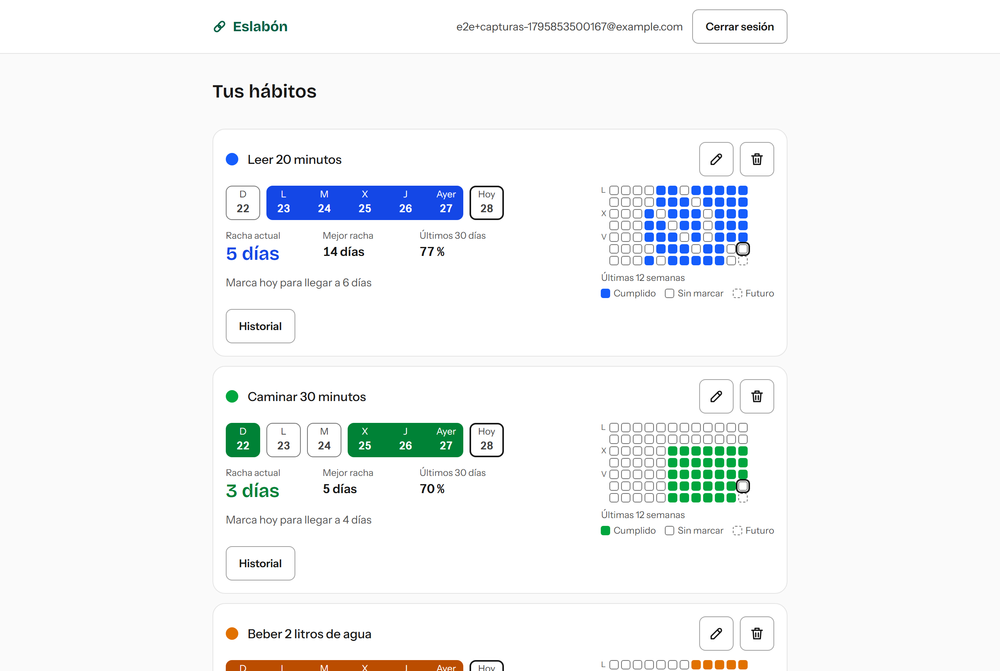
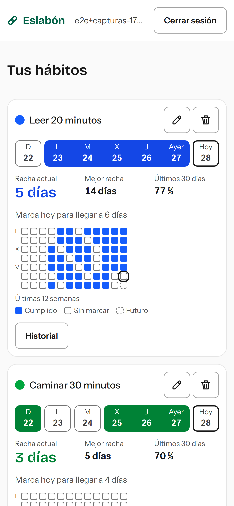
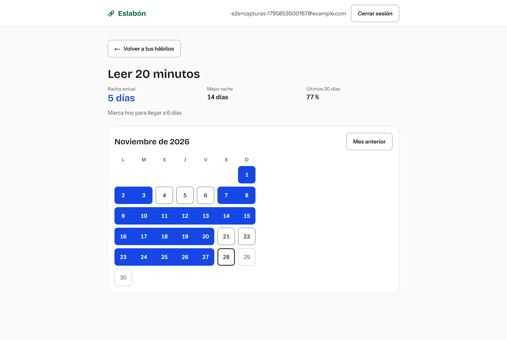
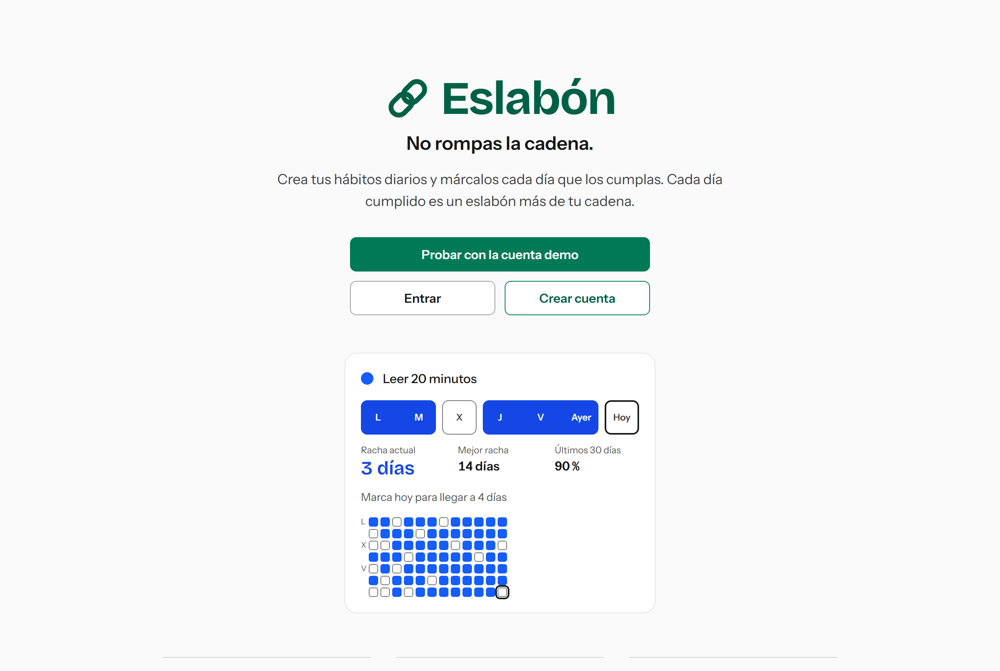
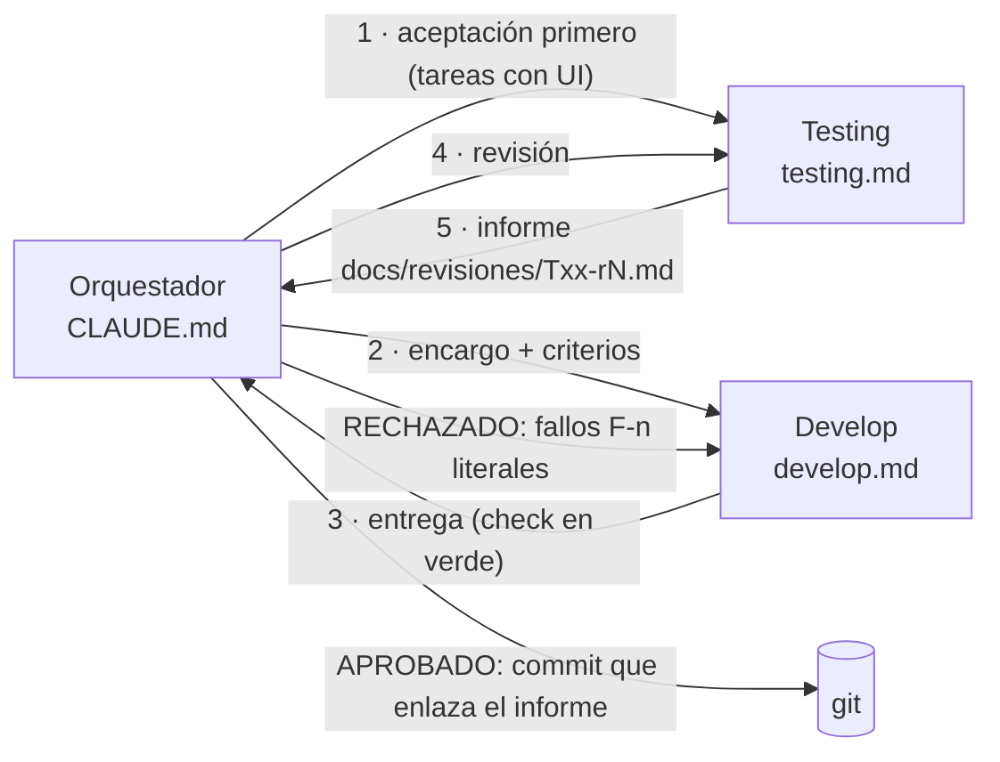

# Eslabón

**No rompas la cadena.** Eslabón es un tracker de hábitos diarios con un bot de Telegram. Lo ha hecho un equipo de tres agentes de Claude Code:
- un **Orquestador** que reparte el trabajo;
- **Develop**, que programa;
- **Testing**, que revisa contra unas directrices y devuelve los fallos hasta que todo pasa.

| | |
|---|---|
| **App (producción)** | **https://eslabon-theta.vercel.app** |
| **Cuenta demo** | el botón «Probar con la cuenta demo», o `demo@example.com` / `Eslabon-demo-2026` |
| **Bot de Telegram** | [@EslabonHabitsBot](https://t.me/EslabonHabitsBot) (se vincula desde la app) |
| **Agentes** | [`CLAUDE.md`](CLAUDE.md) (Orquestador) · [`.claude/agents/develop.md`](.claude/agents/develop.md) · [`.claude/agents/testing.md`](.claude/agents/testing.md) |
| **Rastro de revisiones** | [`docs/revisiones/`](docs/revisiones/README.md): un informe por tarea y por ronda |

La cuenta demo es compartida y lleva datos de ejemplo. Su email y su contraseña no se pueden cambiar porque lo impide un trigger de la base de datos.

<p>
  
  
</p>
<p>
  
  
</p>

---

## Qué hace la app

- **Registro e inicio de sesión** con email y contraseña. Al registrarte entras directamente, sin email de confirmación.
- **Hábitos:** se crean con un nombre y un color, se pueden renombrar y se borran tras confirmar. Hay un máximo de 50 por cuenta.
- **Marcar los días:**
  - **La tarjeta** muestra los 7 últimos días. Los días seguidos se dibujan como una **cadena continua** del color del hábito, y la app avisa cuando hoy está pendiente («Marca hoy para llegar a 6 días»).
  - **El historial de cada hábito** es un calendario mensual navegable, donde se puede marcar o desmarcar **cualquier día desde el 1 de enero de 2000 hasta hoy**.
- **Estadísticas:** la racha actual, la mejor racha de todo el historial, el porcentaje de los últimos 30 días y un mapa de 12 semanas.
- **El «hoy» de cada usuario** se calcula en su zona horaria, no en la UTC del servidor.
- **«Cargar datos de ejemplo»** rellena cualquier cuenta vacía con 3 hábitos y unos 60 días de historial.
- **Se puede instalar** en el móvil o en el escritorio (es una PWA: manifest e iconos). No usa service worker, a propósito, para no guardar datos privados sin conexión.
- **Bot de Telegram:** todo lo de la web también desde el chat: ver los hábitos con sus estadísticas, marcar cualquier día en un calendario, crear, renombrar, borrar y cargar los datos de ejemplo. Se explica en el apartado siguiente.

## Integración: bot de Telegram

Es una integración real con otro sistema, con las mismas piezas que pide una API de mensajería como WhatsApp Business: un webhook verificado, la vinculación segura de cuentas y la idempotencia.

1. En `/app`, la sección **Telegram** tiene el botón **«Vincular con Telegram»**. Genera un **código de un solo uso** que caduca a los 10 minutos y muestra el botón **«Abrir Telegram»**, que lleva a `t.me/EslabonHabitsBot?start=<código>`. También vale enviar `/vincular <código>` al bot.
2. En Telegram, **Iniciar** vincula la cuenta, y el bot confirma en el chat que se ha vinculado.
3. Desde ahí, **todo lo de la web**:
   - **`/hoy`**: los hábitos de hoy con un botón ⬜/✅ por hábito. Al pulsar uno, el día queda marcado o desmarcado y el mensaje se actualiza en el sitio.
   - **`/habitos`**: cada hábito con su racha actual, su mejor racha y el porcentaje de 30 días. Cada uno abre su menú: «📅 Historial», «✏️ Renombrar», «🗑️ Borrar» (con confirmación) y «⬅️ Volver».
   - **«📅 Historial»**: un calendario mensual en botones, navegable desde enero de 2000 hasta hoy, donde cada día hasta hoy se marca o se desmarca de un toque («✅18»).
   - **`/nuevo <nombre>`**: crea un hábito y ofrece la paleta (🔴 🟠 🟡 🟢 🔵 🟣) para elegir el color. Con `/nuevo` a secas, el bot pide el nombre.
   - **«✏️ Renombrar»**: el bot pide el nombre nuevo y lo toma del siguiente mensaje.
   - **`/ejemplo`** carga los datos de ejemplo en una cuenta vacía, y **`/cancelar`** cancela lo que esté a medias.

   Las reglas son las de la web: los mismos mensajes de error, el límite de 50 hábitos y los días desde el 2000-01-01. Lo que se hace en el bot se ve en la app al recargar, y al revés.
4. Hay dos maneras de desvincular: **`/desvincular`** en el chat o **«Desvincular»** en la app. **`/ayuda`** lista los 8 comandos.

**Cómo está hecho, sin la `service_role`:**
- **El webhook** (`POST /api/telegram/webhook`) compara en tiempo constante la cabecera `X-Telegram-Bot-Api-Secret-Token`. Si no coincide, responde 401 sin procesar nada. Si falta el secreto, responde 503.
- **Con el secreto correcto** contesta siempre 200, para que Telegram no reintente en bucle.
- **Para actuar** solo puede llamar a 15 funciones SQL `security definer`, pequeñas y concretas, que exigen un secreto guardado en un esquema `private` que la API no expone.
- **La app no puede leer el `chat_id`**: se le da permiso por columnas y esa no está entre ellas.
- **Solo funciona en chats privados** y los mensajes van en texto plano, así que el nombre de un hábito nunca se interpreta como formato.
- **El texto libre** (el nombre de un hábito) se encamina con un estado por chat que caduca a los 10 minutos, y cualquier comando lo cancela.
- **La lógica del bot** está en una función pura (`handleUpdate`) con 205 tests unitarios. Hay además 65 E2E contra un simulador de la API de Telegram, que comprueban también que las respuestas no llevan el token ni el secreto. En la revisión (T19-r1) se comprobó además que no aparecen en los logs del servidor.

**Cada cuenta se vincula con un solo chat.** La demo es compartida: si la vinculas, la última persona que la vincule se queda con ella. Para probar el bot sin que nadie interfiera, crea tu propia cuenta en `/registro`; se tarda 30 segundos.

## El equipo de agentes



- **Orquestador** ([`CLAUDE.md`](CLAUDE.md)):
  - coge la siguiente tarea de [`tasks/todo.md`](tasks/todo.md);
  - encarga el trabajo a Develop y la revisión a Testing, y arbitra las dudas;
  - hace el commit y se para en los *checkpoints* con el humano.

  **No escribe código de la app.**
- **Develop** ([`develop.md`](.claude/agents/develop.md)) define cómo se programa en este repo:
  - TDD para la lógica;
  - el patrón de Server Action: zod → `getUser()` → error genérico;
  - las reglas de fechas, de Supabase y de accesibilidad.

  Cada regla cita la directriz `D-xx` de Testing que cumple.
- **Testing** ([`testing.md`](.claude/agents/testing.md)) tiene las **DIRECTRICES D-01…D-16**, cada una con **el comando o la inspección que la comprueba**.
  - En las tareas con interfaz **escribe los E2E de aceptación antes que el código**, a partir de los criterios.
  - Develop los ejecuta pero no los puede editar, así que no se puede aprobar a sí mismo.
  - El SQL lo revisa **en dos fases**: primero en una base de datos local (PGlite) con baterías adversariales y mutaciones, antes de aplicarlo, y después contra la base de datos alojada.
- **Los fallos llegan a Develop a través del Orquestador.** En Claude Code un subagente no puede llamar a otro. Por eso Testing escribe el informe y el Orquestador reenvía la lista literal. Así cada ronda queda registrada y se puede revisar.

### Lo que encontró el ciclo (de [`docs/revisiones/`](docs/revisiones/README.md))

Las tareas de T00 a T28 dejaron 44 informes de revisión, con varias rondas de rechazo reales. Algunos ejemplos:

- **T04:**
  - A la regex del matcher del proxy le faltaba un escape, y rutas como `/app/medico` no renovaban la sesión.
  - El `config.jsonc` que genera `supabase init` habría degradado 12 ajustes de producción, entre ellos desactivar MFA. Lo detectó el Orquestador al hacer `config diff` antes de aplicarlo.
- **T05:** un 500 en una Server Action sustituía la página entera por la pantalla de error de Next, en inglés.
- **T09:** la función SQL `security definer` se revisó **antes** de aplicarla, con 44 casos adversariales. Así se cerró un hueco: la zona horaria de la sesión se podía manipular con `Prefer: timezone`.
- **T14b:** el test nuevo de Testing rompía el build. **El CI y Vercel lo pararon** y producción no se vio afectada.
- **T17:** el secreto del bot no tenía un `CHECK` de longitud. Un secreto vacío habría abierto las funciones del bot a cualquiera. Se cerró antes del `db push`.
- **T22:** Develop descubrió en la guía de Next 16 que, con Cache Components, un `notFound()` en la página responde 200. El 404 real del historial lo decide el proxy, y es la misma respuesta para un id inválido, inexistente o ajeno.
- **T24:** una **auditoría de seguridad independiente** ([informe y triaje](tasks/T24-auditoria.md)) no encontró nada crítico ni alto. Al corregir el hallazgo medio, Testing rechazó la migración (F-1): el trigger del límite contaba antes de que actuara la RLS, y eso dejaba saber si otro usuario tenía 50 hábitos.
- **T27:** en el calendario del bot, los días marcados eran solo «✅», sin número. No se sabía qué día se desmarcaba, y un lector de pantalla habría leído «marca de verificación» siete veces seguidas. Testing lo rechazó y ahora se ve «✅18».

## Stack

Next.js 16 (App Router, Server Components, Server Actions, `cacheComponents`) · React 19 · TypeScript estricto · Tailwind CSS 4 · Supabase (Postgres, Auth, RLS) con `@supabase/ssr` · zod · Vitest · Playwright + axe · Vercel · GitHub Actions · API de bots de Telegram.

## Seguridad

- **La base de datos se protege a sí misma.**
  - Hay RLS en todas las tablas, con una política por operación basada en `auth.uid()`, y los grants son explícitos.
  - El update de los hábitos solo afecta a `name` y `color`.
  - Los check-ins no tienen update, a propósito.
  - Un trigger con un lock por usuario limita a 50 los hábitos de cada cuenta, también con inserciones simultáneas.
  - Los E2E lo comprueban **contra la API real**: un usuario no puede leer, editar ni borrar nada de otro.
- **La app solo usa la *publishable key*.** La `service_role` no se usa en ningún sitio, tampoco en el bot.
- **Toda Server Action se valida en el servidor** con zod y `getUser()`, y los errores son genéricos y en español; nunca se muestra el error crudo de la base de datos. El webhook valida el update con zod y cada RPC del bot exige el secreto.
- **Cabeceras:**
  - `X-Frame-Options: DENY` y una CSP con `frame-ancestors 'none'`, `base-uri`, `form-action` y `object-src`;
  - `nosniff` y `Referrer-Policy`;
  - `/app/**` con `Cache-Control: private, no-store`.

  Todas se han comprobado en producción.
- **Cookies de sesión** `httpOnly`, `Secure` y `SameSite=Lax`.
- **La cuenta demo está protegida:**
  - un trigger `before update on auth.users` impide cambiar su email o su contraseña;
  - el cierre de sesión es `scope: "local"`, para no echar a los demás evaluadores.
- **No hay ningún secreto en el repo.** Se ha comprobado en todo el historial. Las variables viven en Vercel y en los secrets de GitHub. `npm audit`: 0 vulnerabilidades.
- **Auditoría final:** [tasks/T24-auditoria.md](tasks/T24-auditoria.md) recoge cada hallazgo y si se ha corregido o se acepta y por qué.

## Calidad y verificación

- **385 tests unitarios** (Vitest) de la lógica pura:
  - fechas, zonas horarias, rachas, cambios de horario y años bisiestos;
  - el calendario mensual, los esquemas y la paginación;
  - el bot de Telegram.
- **308 tests E2E** (Playwright + axe):
  - autenticación, RLS, hábitos, días e historial;
  - estadísticas, datos de ejemplo y landing;
  - accesibilidad (WCAG), móvil a 375 px y movimiento reducido;
  - caché, PWA, cabeceras, cookies y el límite de 50 (incluida la concurrencia real);
  - la integración con Telegram.

  **También pasan contra producción: 243 de 243.** Los otros 65 son los del webhook del bot, que necesitan el simulador local de Telegram.
- **`npm run check`** (lint con 0 warnings, tipos, tests y build) es la puerta de Testing y del [CI](.github/workflows/ci.yml).
- **[Keep-alive](.github/workflows/keepalive.yml)** cada 3 días: inicia sesión, lee los hábitos y la cierra, para que el proyecto gratuito de Supabase no se pause mientras se evalúa.
- **Diseño:** revisado con las skills *impeccable* (dos críticas, cada una con dos subagentes independientes, más su detector) y *emil-design-eng*. Las conclusiones se convirtieron en las tareas T11b–T11d de [`tasks/todo.md`](tasks/todo.md), que citan su origen.

## Ejecutarlo en local

Requisitos: Node 22 y un proyecto de Supabase.

```bash
npm ci
npx playwright install chromium     # navegador para los E2E (npm ci no lo descarga)
cp .env.example .env.local          # rellena NEXT_PUBLIC_SUPABASE_URL, NEXT_PUBLIC_SUPABASE_PUBLISHABLE_KEY, DEMO_*, E2E_USER_* (y TELEGRAM_* para el bot y sus E2E)
npx supabase link --project-ref <ref>
npx supabase db push --remote       # migraciones: esquema, RLS, triggers, la función de datos de ejemplo, el historial, el bot y los límites
npx supabase config push            # auth: sin confirmar email, contraseña de 8 caracteres como mínimo y URLs
                                    # (ajusta site_url de supabase/config.jsonc a tu dominio antes del push)
npm run dev                         # http://localhost:3000
```

**Usuarios:** antes de usar el botón demo o de pasar los E2E, crea en tu proyecto los dos usuarios de `.env.local` (`DEMO_*` y `E2E_USER_*`), por ejemplo registrándote en `/registro`. Después marca el demo como demo en el SQL Editor:

```sql
update auth.users set raw_app_meta_data = raw_app_meta_data || '{"demo": true}' where email = '<DEMO_EMAIL>';
```

Para darle datos, entra con él y pulsa «Cargar datos de ejemplo».

**El bot es opcional.** Si no defines `TELEGRAM_BOT_USERNAME`, la sección dice «Telegram no está disponible ahora mismo» y el resto de la app funciona igual. Para activarlo:
1. Crea un bot con @BotFather.
2. Pon `TELEGRAM_BOT_USERNAME`, `TELEGRAM_BOT_TOKEN` y `TELEGRAM_WEBHOOK_SECRET` (de 32 a 256 caracteres `[A-Za-z0-9_-]`).
3. Inserta el mismo secreto en el SQL Editor: `insert into private.telegram_secret (secret) values ('<TELEGRAM_WEBHOOK_SECRET>');`.
4. Registra el webhook con `setWebhook`: `url` = `https://<tu-dominio>/api/telegram/webhook` (Telegram exige una URL HTTPS pública: un despliegue o un túnel, no `localhost`), `secret_token` = el mismo secreto y `allowed_updates` = `["message","callback_query"]`.

Los E2E de Telegram (`e2e/telegram.spec.ts`, `e2e/telegram-webhook.spec.ts` y `e2e/telegram-bot-api.spec.ts`) necesitan los pasos 2 y 3. No hacen falta el bot real ni `setWebhook`: en local, la app habla con un simulador que arranca la propia suite.

| Comando | Qué hace |
|---|---|
| `npm run check` | lint + typecheck + tests unitarios + build |
| `npm test` | tests unitarios (Vitest) |
| `npm run e2e` | E2E en local (build + `next start` y un simulador de Telegram) |
| `BASE_URL=https://eslabon-theta.vercel.app npm run e2e` | E2E contra producción |

## Decisiones y limitaciones

- **Historial completo, desde el 2000-01-01.**
  - Al principio solo se podían marcar los 7 últimos días, para que la racha fuera honesta. El humano lo cambió el 2026-11-28.
  - La tarjeta sigue mostrando la semana, para el uso diario, y el historial permite completar cualquier día pasado.
  - El servidor rechaza los días futuros (en la zona horaria del usuario) y los anteriores al 2000. La RLS rechaza los anteriores al 2000 y los posteriores a mañana en UTC (ese margen cubre las zonas hasta UTC+14).
- **Registro sin confirmar el email:** el SMTP gratuito de Supabase apenas permite envíos. Por eso el registro dice si un email ya existe y deja registrar un email ajeno.
- **Los formularios de acceso necesitan JavaScript.** El envoltorio que evita la pantalla de error en inglés ante un 500 impide la mejora progresiva.
- **`db advisors` da 18 avisos, todos intencionados y revisados:**
  - las 15 funciones del bot ejecutables por `anon`: es el diseño sin `service_role`, y cada una exige el secreto (probado en todas por la API);
  - `create_telegram_link_code` y `load_sample_data` ejecutables por `authenticated`;
  - `auth_leaked_password_protection`: la comprobación con HaveIBeenPwned solo está disponible [a partir del plan Pro](https://supabase.com/docs/guides/auth/password-security).
- **Riesgos aceptados en la auditoría** (detalle en [T24](tasks/T24-auditoria.md)):
  - el límite de inicios de sesión por IP de Supabase lo comparten todos, porque las peticiones salen desde Vercel;
  - un mismo secreto sirve para el webhook y para las RPC;
  - las Actions se fijan por etiqueta y no por SHA.
- **CSP sin `script-src`:** con Cache Components el shell estático no admite nonces.
- **Naranja y ámbar se parecen**, porque los tonos 600/700 son los que dan el contraste mínimo.
- **GitHub desactiva los workflows programados** de un repo público tras 60 días sin actividad.

## Estructura

```
CLAUDE.md                    Orquestador
.claude/agents/              develop.md y testing.md (directrices D-xx)
SPEC.md · tasks/             especificación, plan, tareas con sus criterios y la auditoría de T24
docs/revisiones/             informes de Testing por tarea y ronda
docs/capturas/               capturas de producción para este README
src/app/                     rutas: / (landing), /login, /registro, /app, /app/habitos/[id], /api/telegram/webhook
src/lib/                     lógica pura (fechas, rachas, esquemas, bot) y clientes de Supabase
supabase/                    migraciones SQL y config de auth (mínima)
e2e/                         tests de aceptación (de Testing)
.github/workflows/           CI y keep-alive
```

---

Hecho con [Claude Code](https://claude.com/claude-code) (Claude Opus 5.5) en el papel de Orquestador, con los subagentes Develop y Testing.
