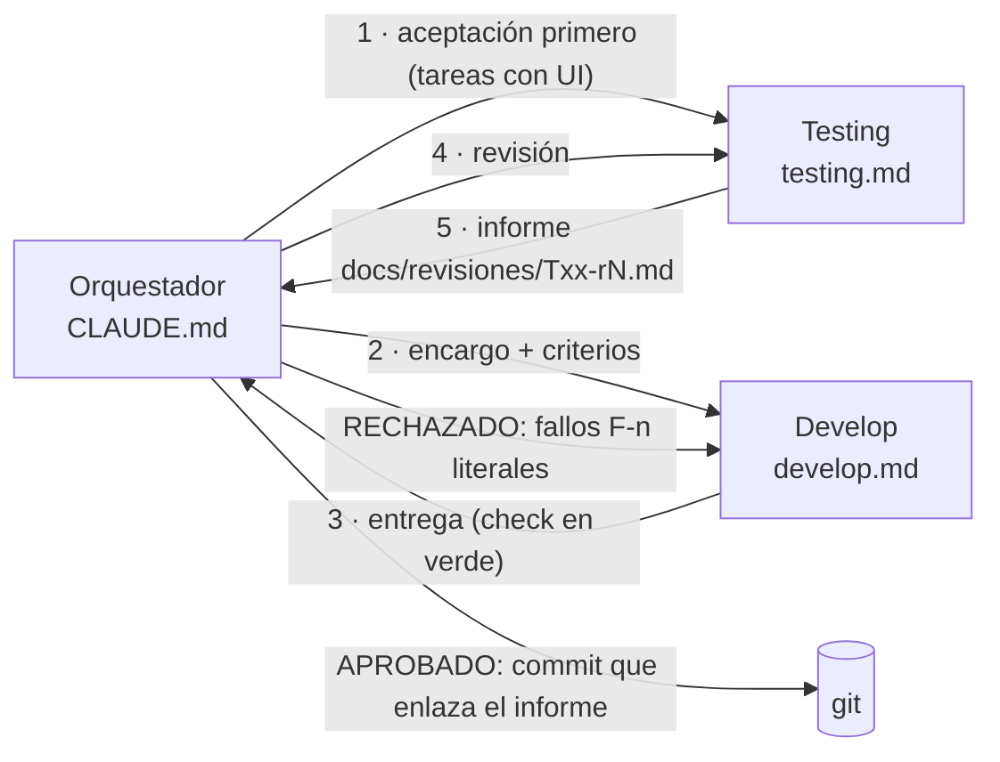

# Eslabón

**No rompas la cadena.** Un tracker de hábitos diarios hecho por un equipo de tres agentes de Claude Code: un **Orquestador** que reparte el trabajo, **Develop**, que programa, y **Testing**, que revisa contra unas directrices y devuelve los fallos hasta que todo pasa.

| | |
|---|---|
| **App (producción)** | **https://eslabon-theta.vercel.app** |
| **Cuenta demo** | botón «Probar con la cuenta demo», o `demo@example.com` / `Eslabon-demo-2026` |
| **Agentes** | [`CLAUDE.md`](CLAUDE.md) (Orquestador) · [`.claude/agents/develop.md`](.claude/agents/develop.md) · [`.claude/agents/testing.md`](.claude/agents/testing.md) |
| **Rastro de revisiones** | [`docs/revisiones/`](docs/revisiones/README.md): un informe por tarea y ronda |

La cuenta demo es compartida y lleva datos de ejemplo. Su email y su contraseña no se pueden cambiar: lo impide un trigger en la base de datos.

---

## Qué hace la app

- **Registro e inicio de sesión** con email y contraseña. Al registrarte entras directamente, sin email de confirmación.
- **Hábitos:** se pueden crear (nombre y color), renombrar y borrar con confirmación.
- **Marcar los 7 últimos días.** Los días seguidos se dibujan como una **cadena continua** del color del hábito, y la app avisa de cuándo hoy está pendiente («Marca hoy para llegar a 6 días»).
- **Estadísticas:** racha actual, mejor racha de todo el historial, porcentaje de los últimos 30 días y un mapa de 12 semanas.
- **El «hoy» de cada usuario:** se calcula en su zona horaria, no en la UTC del servidor.
- **«Cargar datos de ejemplo»:** rellena cualquier cuenta vacía con 3 hábitos y unos 60 días de historial.

## El equipo de agentes



- **Orquestador** ([`CLAUDE.md`](CLAUDE.md)): coge la siguiente tarea de [`tasks/todo.md`](tasks/todo.md), encarga el trabajo a Develop y la revisión a Testing, arbitra las dudas, hace el commit y para en los *checkpoints* con el humano. **No escribe código de la app.**
- **Develop** ([`develop.md`](.claude/agents/develop.md)): cómo se programa en este repo. Usa TDD para la lógica, el patrón de Server Action (zod → `getUser()` → error genérico) y las reglas de fechas, Supabase y accesibilidad. Cada regla cita la directriz `D-xx` de Testing que cumple.
- **Testing** ([`testing.md`](.claude/agents/testing.md)): las **DIRECTRICES D-01…D-16**, cada una con **el comando o la inspección que la comprueba**. Además, en las tareas con interfaz **escribe los E2E de aceptación antes que el código** y a partir de los criterios. Develop los ejecuta pero no los puede editar, así que no se puede aprobar a sí mismo.
- **Los fallos llegan a Develop a través del Orquestador.** En Claude Code un subagente no puede llamar a otro, así que Testing escribe el informe y el Orquestador reenvía la lista literal. Así cada ronda queda registrada y se puede revisar.

### Lo que encontró el ciclo (de [`docs/revisiones/`](docs/revisiones/README.md))

Las 19 tareas de desarrollo y publicación (de T00 a T14b) dejaron 24 informes de revisión, con varias rondas de rechazo reales. Algunos ejemplos:

- **T04:** a la regex del matcher del proxy le faltaba un escape, y rutas como `/app/medico` no renovaban la sesión. Además, el `config.jsonc` que genera `supabase init` habría degradado 12 ajustes de producción (entre ellos, desactivar MFA). Lo detectó el Orquestador al hacer `config diff` antes de aplicarlo.
- **T05:** un 500 en una Server Action sustituía la página entera por la pantalla de error de Next, en inglés.
- **T06:** con una petición manipulada, la app mostraba el mensaje interno de zod en inglés. El mismo hueco se encontró y se corrigió en el login.
- **T07:** Develop demostró que un test de Testing estaba mal. Testing lo verificó, lo corrigió y lo dejó documentado.
- **T09:** la función SQL `security definer` se revisó **antes** de aplicarla, con 44 casos adversariales, y se cerró un hueco: la zona horaria de la sesión se podía manipular con `Prefer: timezone`.
- **T14b:** el test nuevo de Testing rompía el build. **El CI y Vercel lo pararon**, producción no se vio afectada, y Testing reconoció su error en el informe.

## Stack

Next.js 16 (App Router, Server Components, Server Actions, `cacheComponents`) · React 19 · TypeScript estricto · Tailwind CSS 4 · Supabase (Postgres, Auth, RLS) con `@supabase/ssr` · zod · Vitest · Playwright + axe · Vercel · GitHub Actions.

## Seguridad

- **La base de datos se protege a sí misma.** Hay RLS en todas las tablas, con una política por operación basada en `auth.uid()`. Además: grants explícitos, update de hábitos solo sobre `name` y `color`, y check-ins sin update a propósito (se marcan y se desmarcan, nunca se modifican) y limitados por la RLS a una ventana de días. Los E2E lo comprueban **contra la API real**: un usuario no puede leer, editar ni borrar nada de otro.
- **La app solo usa la *publishable key*.** La `service_role` no se usa en ningún sitio.
- **Toda mutación valida en el servidor:** zod, `getUser()` y errores genéricos en español, nunca el error crudo de la base de datos.
- **Cuenta demo protegida:** un trigger `before update on auth.users` impide cambiar su email o su contraseña, y el cierre de sesión es `scope: "local"` para no echar a los demás evaluadores.
- **Ningún secreto en el repo.** Se ha comprobado en todo el historial antes del primer push. Las variables viven en Vercel y en los secrets de GitHub.
- **`/app` se sirve con `Cache-Control: private, no-store`,** verificado en producción.

## Calidad y verificación

- **139 tests unitarios** (Vitest): fechas, zonas horarias, rachas, cambios de horario, bisiestos, esquemas y paginación.
- **169 tests E2E** (Playwright + axe): autenticación, RLS, hábitos, días, estadísticas, datos de ejemplo, landing, accesibilidad (WCAG), móvil a 375 px, movimiento reducido, cadena y caché. **La suite completa pasa también contra producción.**
- **`npm run check`** (lint con 0 warnings, tipos, tests y build) es la puerta de Testing y del [CI](.github/workflows/ci.yml).
- **[Keep-alive](.github/workflows/keepalive.yml)** cada 3 días: hace login, lee los hábitos y cierra la sesión, para que el proyecto gratuito de Supabase no se pause mientras se evalúa.
- **Diseño:** revisado con las skills *impeccable* (dos críticas con dos subagentes independientes cada una, más su detector) y *emil-design-eng*. Las conclusiones se convirtieron en las tareas T11b–T11d de [`tasks/todo.md`](tasks/todo.md), que citan su origen. Los snapshots de la herramienta son locales y no están en el repo.

## Ejecutarlo en local

Requisitos: Node 22 y un proyecto de Supabase.

```bash
npm ci
npx playwright install chromium     # navegador para los E2E (npm ci no lo descarga)
cp .env.example .env.local          # rellena NEXT_PUBLIC_SUPABASE_URL, NEXT_PUBLIC_SUPABASE_PUBLISHABLE_KEY, DEMO_*, E2E_USER_*
npx supabase link --project-ref <ref>
npx supabase db push --remote       # migraciones: esquema, RLS, trigger de la demo y la función de datos de ejemplo
npx supabase config push            # auth: sin confirmar email, contraseña de 8 caracteres como mínimo y URLs
                                    # (ajusta site_url de supabase/config.jsonc a tu dominio antes del push)
npm run dev                         # http://localhost:3000
```

Antes de usar el botón demo o de pasar los E2E, crea en tu proyecto los dos usuarios de `.env.local` (`DEMO_*` y `E2E_USER_*`), por ejemplo registrándote en `/registro`. Después marca el demo con `update auth.users set raw_app_meta_data = raw_app_meta_data || '{"demo": true}' where email = '<DEMO_EMAIL>';` en el SQL Editor. Para darle datos, entra con él y pulsa «Cargar datos de ejemplo».

| Comando | Qué hace |
|---|---|
| `npm run check` | lint + typecheck + tests unitarios + build |
| `npm test` | tests unitarios (Vitest) |
| `npm run e2e` | E2E en local (arranca `next dev`) |
| `BASE_URL=https://eslabon-theta.vercel.app npm run e2e` | E2E contra producción |

## Decisiones y limitaciones

- **Solo se pueden marcar los 7 últimos días.** Es una decisión de producto, confirmada durante el desarrollo: así la racha es honesta (no se puede rellenar un mes a posteriori), no hay que ampliar la RLS y no hacen falta 84 botones por hábito.
- **Registro sin confirmar el email:** el SMTP gratuito de Supabase apenas permite envíos.
- **Los formularios de acceso necesitan JavaScript.** El envoltorio que evita la pantalla de error en inglés ante un 500 impide la mejora progresiva.
- **`db advisors` da 2 avisos documentados.**
  - `authenticated_security_definer_function_executable`: es intencionado, porque `load_sample_data` tiene que poder llamarla un usuario con sesión, y está blindada y revisada.
  - `auth_leaked_password_protection`: la comprobación con HaveIBeenPwned solo está disponible [a partir del plan Pro](https://supabase.com/docs/guides/auth/password-security).
- **Naranja y ámbar se parecen**, porque los tonos 600/700 son los que dan el contraste mínimo.
- **GitHub desactiva los workflows programados** de un repo público tras 60 días sin actividad.

## Estructura

```
CLAUDE.md                    Orquestador
.claude/agents/              develop.md y testing.md (directrices D-xx)
SPEC.md · tasks/             especificación, plan y tareas con sus criterios
docs/revisiones/             informes de Testing por tarea y ronda
src/app/                     rutas: / (landing), /login, /registro, /app
src/lib/                     lógica pura (fechas, rachas, esquemas) y clientes de Supabase
supabase/                    migraciones SQL y config de auth (mínima)
e2e/                         tests de aceptación (de Testing)
.github/workflows/           CI y keep-alive
```

---

Hecho con [Claude Code](https://claude.com/claude-code) (Claude Opus 5.5) en el papel de Orquestador, con los subagentes Develop y Testing.
